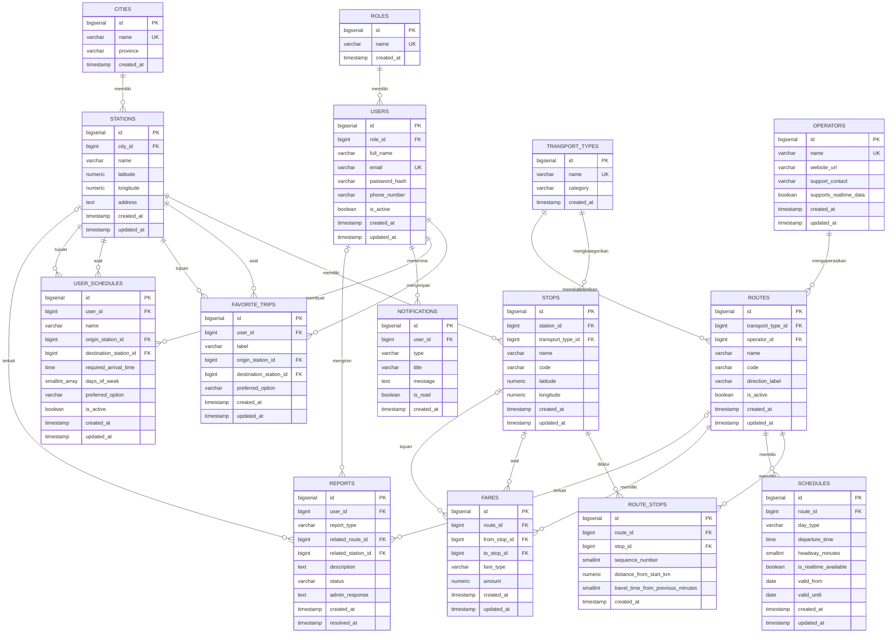

# ERD — TRANSIT (Jabodetabek Mobility Planner)

**Entity Relationship Diagram & Database Design**

| Item | Keterangan |
|---|---|
| Nama Produk | TRANSIT — Jabodetabek Mobility Planner |
| Jenis Dokumen | Entity Relationship Diagram (ERD) & Database Design |
| Versi | 1.0 |
| Target Database | PostgreSQL |
| Dokumen Terkait | `PRD.md` (Product Requirements Document), `style.md` (Design System) |

---

## 1. Pendekatan & Prinsip Desain

Sebelum masuk ke detail entitas, berikut prinsip yang digunakan secara konsisten di seluruh skema:

1. **Normalisasi wajar (hingga 3NF)** — data acuan seperti operator, moda transportasi, dan kota dipisahkan agar tidak terjadi duplikasi teks yang sama di banyak baris.
2. **Primary key seragam** — seluruh tabel menggunakan `BIGSERIAL` (integer auto-increment) sebagai primary key, demi kesederhanaan dan kemudahan dipahami untuk skala proyek sekolah. UUID dapat dipertimbangkan di masa depan apabila ID mulai diekspos langsung pada URL publik dan enumerasi menjadi risiko keamanan.
3. **Penamaan konsisten** — nama tabel menggunakan `snake_case` bentuk jamak (contoh: `stations`, `route_stops`); nama kolom menggunakan `snake_case`.
4. **Timestamp standar** — mayoritas tabel memiliki `created_at`, dan tabel yang datanya dapat diubah memiliki tambahan `updated_at`.
5. **Tidak ada tabel yang dibuat "karena mungkin berguna"** — setiap tabel di bawah ini memiliki fitur MUST HAVE/SHOULD HAVE di `PRD.md` yang secara langsung membutuhkannya (lihat §9 — Pemetaan Entity ke Fitur).

### Keputusan Desain Penting (Assumptions)

| Keputusan | Alasan |
|---|---|
| Satu arah perjalanan pada rute dua arah (misalnya KRL atau TransJakarta) dimodelkan sebagai **baris `routes` terpisah** untuk tiap arah. | Menjaga `sequence_number` pada `route_stops` tetap sederhana dan monoton (1, 2, 3, …) tanpa perlu logika arah tambahan — realistis untuk kompleksitas proyek sekolah. |
| Segmen **berjalan kaki** antar dua titik pemberhentian **tidak disimpan** sebagai baris pada tabel `routes`. | Segmen jalan kaki dihitung dinamis oleh logika Route Planning (lihat `PRD.md` §20) berdasarkan koordinat `stops`, bukan data statis bertarif/berjadwal seperti moda umum. Menyimpannya sebagai `routes` akan memaksakan struktur operator/schedule/fare yang tidak relevan untuk berjalan kaki. |
| **Kota (city)** dipisahkan sebagai tabel tersendiri, bukan kolom teks bebas pada `stations`. | Kota dipakai berulang sebagai filter (`PRD.md` §22, Transport Explorer) dan sebagai atribut banyak `stations` sekaligus — memisahkannya mencegah duplikasi & inkonsistensi penulisan nama kota (contoh: "Jakarta Selatan" vs "Jaksel"). **Provinsi** cukup disimpan sebagai kolom pada `cities` (bukan tabel `provinces` terpisah) karena Jabodetabek hanya mencakup 3 provinsi dan provinsi tidak pernah menjadi filter/relasi mandiri. |
| **Trip / Search Result tidak dijadikan tabel tersendiri.** | Hasil pencarian Journey Planner bersifat *komputasi sesaat* (dihitung ulang setiap kali dari `routes` + `route_stops` + `schedules` + `fares`), bukan data yang perlu disimpan permanen. Kebutuhan "menyimpan perjalanan" sudah terpenuhi oleh `favorite_trips` dan `user_schedules`. Menambah tabel `trips` untuk menyimpan hasil pencarian sesaat akan melanggar instruksi untuk tidak membuat tabel tanpa alasan jelas. |
| **Stops** dipisahkan dari **Stations**. | `stations` merepresentasikan *tempat* yang dikenal pengguna (contoh: "Stasiun Manggarai") dan dipakai sebagai titik asal/tujuan pencarian. `stops` merepresentasikan *titik operasional* di tempat tersebut untuk moda tertentu (contoh: peron KRL Manggarai vs halte TransJakarta Manggarai), yang dibutuhkan agar satu rute dapat merujuk ke titik pemberhentian yang presisi per moda tanpa menduplikasi nama/koordinat station berulang kali. |

---

## 2. Daftar Entity

| # | Entity | Alasan Dibutuhkan |
|---|---|---|
| 1 | `roles` | Membedakan hak akses Guest/User/Admin (`PRD.md` §18). |
| 2 | `users` | Autentikasi & pemilik data personalisasi (`PRD.md` §13.1). |
| 3 | `cities` | Filter Kota pada Transport Explorer (`PRD.md` §22) & atribut `stations`. |
| 4 | `operators` | Data operator transportasi yang dikelola Admin (`PRD.md` §19). |
| 5 | `transport_types` | Kategori moda (KRL/MRT/LRT/TransJakarta) untuk `routes` dan `stops`. |
| 6 | `stations` | Titik asal/tujuan pencarian pengguna (`PRD.md` §13.2, §13.6). |
| 7 | `stops` | Titik pemberhentian spesifik per moda dalam satu rute (`PRD.md` §13.7 Route Detail). |
| 8 | `routes` | Data rute per operator/moda yang dikelola Admin dan dicari Smart Route Recommendation. |
| 9 | `route_stops` | Relasi banyak-ke-banyak rute↔pemberhentian beserta urutannya (`PRD.md` §20). |
| 10 | `schedules` | Jadwal/headway keberangkatan per rute untuk perhitungan Arrive On Time (`PRD.md` §21). |
| 11 | `fares` | Estimasi biaya per rute/segmen untuk Smart Route Recommendation & Arrive On Time. |
| 12 | `favorite_trips` | Fitur Favorite Trip & My Trips (`PRD.md` §13.8, §13.9). |
| 13 | `user_schedules` | Fitur My Schedule (`PRD.md` §13.10). |
| 14 | `notifications` | Pendukung pengingat My Schedule & pembaruan status User Report (`PRD.md` §11 bagian D). |
| 15 | `reports` | Fitur User Report & pengelolaannya di Admin Dashboard (`PRD.md` §13.11, §13.12). |

**Entitas yang secara sengaja tidak dibuat**, beserta alasannya, dijelaskan pada §1 (Trip/Search Result) — tidak ada entitas lain di luar 15 di atas yang dibutuhkan oleh fitur MUST HAVE maupun SHOULD HAVE pada `PRD.md`.

---

## 3. ERD (Format Mermaid)

> Catatan notasi: `|o--o{` menandakan sisi tersebut *nullable* (foreign key boleh kosong), digunakan pada relasi `users → reports` dan `stations/routes → reports` karena `reports.user_id`, `reports.related_route_id`, dan `reports.related_station_id` bersifat opsional (lihat §5 dan §7).

---

## 4. Penjelasan Setiap Entity

### 4.1 `roles`

Menyimpan daftar peran akses dalam sistem (`user`, `admin`). Dipisahkan dari `users` agar penambahan peran baru di masa depan (misalnya `moderator`) tidak memerlukan perubahan struktur tabel `users`.

| Field | Tipe | Constraint | Nullable | Keterangan |
|---|---|---|---|---|
| `id` | BIGSERIAL | PK | No | Identitas unik role. |
| `name` | VARCHAR(30) | UNIQUE | No | `'user'` atau `'admin'`. |
| `created_at` | TIMESTAMP | DEFAULT now() | No | Waktu data dibuat. |

### 4.2 `users`

Akun pengguna, mencakup Registered User maupun Admin (dibedakan lewat `role_id`). Guest tidak memiliki baris pada tabel ini.

| Field | Tipe | Constraint | Nullable | Keterangan |
|---|---|---|---|---|
| `id` | BIGSERIAL | PK | No | |
| `role_id` | BIGINT | FK → `roles.id` | No | Peran akun. |
| `full_name` | VARCHAR(100) | — | No | |
| `email` | VARCHAR(150) | UNIQUE | No | Digunakan untuk login. |
| `password_hash` | VARCHAR(255) | — | No | Kata sandi dalam bentuk hash. |
| `phone_number` | VARCHAR(20) | — | Yes | Opsional, untuk kontak/notifikasi lanjutan. |
| `is_active` | BOOLEAN | DEFAULT true | No | Untuk fitur nonaktifkan akun oleh Admin (`PRD.md` FR-ADM-08). |
| `created_at` | TIMESTAMP | DEFAULT now() | No | |
| `updated_at` | TIMESTAMP | DEFAULT now() | No | |

### 4.3 `cities`

Daftar kota/wilayah dalam cakupan Jabodetabek. Digunakan sebagai atribut `stations` dan filter pada Transport Explorer.

| Field | Tipe | Constraint | Nullable | Keterangan |
|---|---|---|---|---|
| `id` | BIGSERIAL | PK | No | |
| `name` | VARCHAR(60) | UNIQUE | No | Contoh: "Bekasi", "Jakarta Selatan", "Depok". |
| `province` | VARCHAR(60) | — | No | Contoh: "DKI Jakarta", "Jawa Barat", "Banten". |
| `created_at` | TIMESTAMP | DEFAULT now() | No | |

### 4.4 `operators`

Perusahaan/lembaga penyelenggara moda transportasi (contoh: KAI Commuter, MRT Jakarta, PT Transportasi Jakarta, LRT Jabodebek).

| Field | Tipe | Constraint | Nullable | Keterangan |
|---|---|---|---|---|
| `id` | BIGSERIAL | PK | No | |
| `name` | VARCHAR(100) | UNIQUE | No | |
| `website_url` | VARCHAR(255) | — | Yes | Referensi sumber data resmi. |
| `support_contact` | VARCHAR(100) | — | Yes | |
| `supports_realtime_data` | BOOLEAN | DEFAULT false | No | Menandai apakah operator diketahui menyediakan data real-time — mendukung Aturan Penting #13 ("jangan menganggap semua operator menyediakan data real-time"). |
| `created_at` / `updated_at` | TIMESTAMP | DEFAULT now() | No | |

### 4.5 `transport_types`

Kategori moda transportasi yang didukung sistem.

| Field | Tipe | Constraint | Nullable | Keterangan |
|---|---|---|---|---|
| `id` | BIGSERIAL | PK | No | |
| `name` | VARCHAR(50) | UNIQUE | No | Contoh: "KRL Commuter Line", "MRT Jakarta", "LRT Jabodebek", "TransJakarta". |
| `category` | VARCHAR(30) | CHECK IN (`'rail'`,`'brt'`,`'bus'`,`'other'`) | No | Dipakai untuk pengelompokan & aksen visual (`style.md` §3 — Transport mode accents). |
| `created_at` | TIMESTAMP | DEFAULT now() | No | |

### 4.6 `stations`

Titik lokasi fisik yang dikenal pengguna sebagai asal/tujuan (contoh: "Stasiun Manggarai", "Terminal Kampung Rambutan").

| Field | Tipe | Constraint | Nullable | Keterangan |
|---|---|---|---|---|
| `id` | BIGSERIAL | PK | No | |
| `city_id` | BIGINT | FK → `cities.id` | No | |
| `name` | VARCHAR(100) | — | No | |
| `latitude` | NUMERIC(9,6) | — | No | Untuk Interactive Map. |
| `longitude` | NUMERIC(9,6) | — | No | Untuk Interactive Map. |
| `address` | TEXT | — | Yes | |
| `created_at` / `updated_at` | TIMESTAMP | DEFAULT now() | No | |

Constraint tambahan: `UNIQUE (name, city_id)` untuk mencegah duplikasi entri stasiun yang sama pada kota yang sama.

### 4.7 `stops`

Titik pemberhentian operasional milik satu `station`, spesifik per moda transportasi (contoh: peron KRL vs halte TransJakarta yang sama-sama berada di area Stasiun Manggarai).

| Field | Tipe | Constraint | Nullable | Keterangan |
|---|---|---|---|---|
| `id` | BIGSERIAL | PK | No | |
| `station_id` | BIGINT | FK → `stations.id` | No | |
| `transport_type_id` | BIGINT | FK → `transport_types.id` | No | |
| `name` | VARCHAR(100) | — | No | Contoh: "Peron 3 KRL Manggarai". |
| `code` | VARCHAR(30) | — | Yes | Kode resmi dari operator, bila tersedia. |
| `latitude` | NUMERIC(9,6) | — | Yes | Diisi hanya bila koordinat berbeda dari `stations` induknya. |
| `longitude` | NUMERIC(9,6) | — | Yes | |
| `created_at` / `updated_at` | TIMESTAMP | DEFAULT now() | No | |

Constraint tambahan: `UNIQUE (station_id, transport_type_id, name)`.

### 4.8 `routes`

Satu baris merepresentasikan satu jalur pada satu arah tertentu (lihat Keputusan Desain §1).

| Field | Tipe | Constraint | Nullable | Keterangan |
|---|---|---|---|---|
| `id` | BIGSERIAL | PK | No | |
| `transport_type_id` | BIGINT | FK → `transport_types.id` | No | |
| `operator_id` | BIGINT | FK → `operators.id` | No | |
| `name` | VARCHAR(150) | — | No | Contoh: "KRL Lin Bekasi arah Jakarta Kota". |
| `code` | VARCHAR(30) | — | Yes | Contoh: "Koridor 1". |
| `direction_label` | VARCHAR(100) | — | Yes | Contoh: "Bekasi → Jakarta Kota", untuk kejelasan tampilan. |
| `is_active` | BOOLEAN | DEFAULT true | No | Rute nonaktif tidak diikutkan dalam Smart Route Recommendation (`PRD.md` FR-ADM-10). |
| `created_at` / `updated_at` | TIMESTAMP | DEFAULT now() | No | |

### 4.9 `route_stops`

Tabel penghubung (junction table) antara `routes` dan `stops`, sekaligus menyimpan urutan pemberhentian. Ini adalah entitas yang mewujudkan requirement: *"satu route bisa memiliki banyak stops, satu stop bisa digunakan beberapa route"* — relasi many-to-many.

| Field | Tipe | Constraint | Nullable | Keterangan |
|---|---|---|---|---|
| `id` | BIGSERIAL | PK | No | |
| `route_id` | BIGINT | FK → `routes.id` | No | |
| `stop_id` | BIGINT | FK → `stops.id` | No | |
| `sequence_number` | SMALLINT | — | No | Urutan pemberhentian dalam rute (1, 2, 3, …). |
| `distance_from_start_km` | NUMERIC(6,2) | — | Yes | Untuk perhitungan tarif berbasis jarak. |
| `travel_time_from_previous_minutes` | SMALLINT | — | Yes | Estimasi waktu tempuh dari pemberhentian sebelumnya — dipakai langsung oleh logika Arrive On Time (`PRD.md` §21). |
| `created_at` | TIMESTAMP | DEFAULT now() | No | |

Constraint tambahan: `UNIQUE (route_id, sequence_number)` dan `UNIQUE (route_id, stop_id)` — satu pemberhentian tidak berulang dalam satu rute yang sama (asumsi: tidak ada rute melingkar/*loop* pada cakupan MVP).

### 4.10 `schedules`

Jadwal keberangkatan dari pemberhentian pertama suatu rute. Mendukung dua model: jadwal waktu tetap (`departure_time`) maupun berbasis frekuensi (`headway_minutes`).

| Field | Tipe | Constraint | Nullable | Keterangan |
|---|---|---|---|---|
| `id` | BIGSERIAL | PK | No | |
| `route_id` | BIGINT | FK → `routes.id` | No | |
| `day_type` | VARCHAR(20) | CHECK IN (`'weekday'`,`'weekend'`,`'holiday'`) | No | |
| `departure_time` | TIME | — | No | Keberangkatan pertama pada hari tersebut. |
| `headway_minutes` | SMALLINT | — | Yes | Interval keberangkatan berikutnya, bila rute beroperasi berbasis frekuensi (contoh: TransJakarta). |
| `is_realtime_available` | BOOLEAN | DEFAULT false | No | Menegaskan status data (statis vs real-time) pada level jadwal, melengkapi `operators.supports_realtime_data`. |
| `valid_from` | DATE | — | Yes | Awal masa berlaku jadwal. |
| `valid_until` | DATE | — | Yes | Akhir masa berlaku jadwal (bila ada perubahan jadwal terjadwal). |
| `created_at` / `updated_at` | TIMESTAMP | DEFAULT now() | No | |

### 4.11 `fares`

Estimasi tarif, mendukung tarif flat per rute (`from_stop_id`/`to_stop_id` kosong) maupun tarif berbasis segmen jarak (keduanya diisi).

| Field | Tipe | Constraint | Nullable | Keterangan |
|---|---|---|---|---|
| `id` | BIGSERIAL | PK | No | |
| `route_id` | BIGINT | FK → `routes.id` | No | |
| `from_stop_id` | BIGINT | FK → `stops.id` | Yes | Kosong berarti tarif flat untuk seluruh rute. |
| `to_stop_id` | BIGINT | FK → `stops.id` | Yes | |
| `fare_type` | VARCHAR(20) | CHECK IN (`'flat'`,`'distance_based'`) | No | |
| `amount` | NUMERIC(10,2) | — | No | Nilai dalam Rupiah. |
| `created_at` / `updated_at` | TIMESTAMP | DEFAULT now() | No | |

Constraint tambahan: `UNIQUE (route_id, from_stop_id, to_stop_id)`; disarankan CHECK constraint agar `fare_type = 'flat'` mengharuskan kedua kolom stop kosong, sedangkan `'distance_based'` mengharuskan keduanya terisi (lihat §7).

### 4.12 `favorite_trips`

Perjalanan yang disimpan pengguna sebagai favorit (fitur *Favorite Trip*, ditampilkan pada halaman *My Trips*).

| Field | Tipe | Constraint | Nullable | Keterangan |
|---|---|---|---|---|
| `id` | BIGSERIAL | PK | No | |
| `user_id` | BIGINT | FK → `users.id` | No | |
| `label` | VARCHAR(100) | — | No | Contoh: "Rumah → Kantor". |
| `origin_station_id` | BIGINT | FK → `stations.id` | No | |
| `destination_station_id` | BIGINT | FK → `stations.id` | No | |
| `preferred_option` | VARCHAR(30) | CHECK IN (`'fastest'`,`'cheapest'`,`'min_transfer'`,`'min_walk'`,`'most_comfortable'`) | No | DEFAULT `'fastest'`. |
| `created_at` / `updated_at` | TIMESTAMP | DEFAULT now() | No | |

Constraint tambahan: `UNIQUE (user_id, label)` — satu pengguna tidak memiliki dua favorit dengan nama yang sama.

### 4.13 `user_schedules`

Rutinitas perjalanan berulang milik pengguna (fitur *My Schedule*).

| Field | Tipe | Constraint | Nullable | Keterangan |
|---|---|---|---|---|
| `id` | BIGSERIAL | PK | No | |
| `user_id` | BIGINT | FK → `users.id` | No | |
| `name` | VARCHAR(100) | — | No | Contoh: "Kuliah". |
| `origin_station_id` | BIGINT | FK → `stations.id` | No | |
| `destination_station_id` | BIGINT | FK → `stations.id` | No | |
| `required_arrival_time` | TIME | — | No | Target jam tiba. |
| `days_of_week` | SMALLINT[] | — | No | Array hari aktif (1=Senin … 7=Minggu). Digunakan sebagai kolom array PostgreSQL, bukan tabel terpisah, karena himpunan nilainya kecil dan tetap (maksimal 7) — menghindari tabel junction yang tidak proporsional dengan kebutuhannya. |
| `preferred_option` | VARCHAR(30) | CHECK IN (sama seperti `favorite_trips`) | No | DEFAULT `'fastest'`. |
| `is_active` | BOOLEAN | DEFAULT true | No | Mendukung fitur nonaktifkan sementara (`PRD.md` FR-MS-04). |
| `created_at` / `updated_at` | TIMESTAMP | DEFAULT now() | No | |

### 4.14 `notifications`

Notifikasi dalam aplikasi (kategori NICE TO HAVE pada `PRD.md`, namun entitasnya tetap didokumentasikan karena menjadi kebutuhan turunan langsung dari My Schedule dan User Report).

| Field | Tipe | Constraint | Nullable | Keterangan |
|---|---|---|---|---|
| `id` | BIGSERIAL | PK | No | |
| `user_id` | BIGINT | FK → `users.id` | No | |
| `type` | VARCHAR(30) | CHECK IN (`'schedule_reminder'`,`'service_disruption'`,`'report_update'`,`'system_info'`) | No | |
| `title` | VARCHAR(150) | — | No | |
| `message` | TEXT | — | No | |
| `is_read` | BOOLEAN | DEFAULT false | No | |
| `created_at` | TIMESTAMP | DEFAULT now() | No | |

### 4.15 `reports`

Laporan pengguna terkait data tidak akurat atau gangguan layanan (fitur *User Report*).

| Field | Tipe | Constraint | Nullable | Keterangan |
|---|---|---|---|---|
| `id` | BIGSERIAL | PK | No | |
| `user_id` | BIGINT | FK → `users.id`, `ON DELETE SET NULL` | Yes | Nullable agar riwayat laporan tetap tersimpan meski akun pelapor kelak dihapus. |
| `report_type` | VARCHAR(30) | CHECK IN (`'data_salah'`,`'jadwal_tidak_akurat'`,`'layanan_terganggu'`,`'bug_aplikasi'`,`'lainnya'`) | No | |
| `related_route_id` | BIGINT | FK → `routes.id`, `ON DELETE SET NULL` | Yes | Diisi bila laporan terkait rute tertentu. |
| `related_station_id` | BIGINT | FK → `stations.id`, `ON DELETE SET NULL` | Yes | Diisi bila laporan terkait stasiun tertentu. |
| `description` | TEXT | — | No | |
| `status` | VARCHAR(20) | CHECK IN (`'pending'`,`'reviewed'`,`'resolved'`,`'rejected'`) | No | DEFAULT `'pending'`. |
| `admin_response` | TEXT | — | Yes | |
| `created_at` | TIMESTAMP | DEFAULT now() | No | |
| `resolved_at` | TIMESTAMP | — | Yes | Diisi saat status berubah menjadi `'resolved'`/`'rejected'`. |

---

## 5. Relasi Antar Entity

| Relasi | Kardinalitas | Keterangan |
|---|---|---|
| `roles` → `users` | 1 ke N | Satu role dimiliki banyak user; satu user memiliki tepat satu role. |
| `cities` → `stations` | 1 ke N | Satu kota memiliki banyak stasiun. |
| `stations` → `stops` | 1 ke N | Satu stasiun memiliki satu atau lebih titik pemberhentian per moda. |
| `transport_types` → `stops` | 1 ke N | |
| `transport_types` → `routes` | 1 ke N | |
| `operators` → `routes` | 1 ke N | |
| `routes` ↔ `stops` (melalui `route_stops`) | N ke N | Satu rute memiliki banyak pemberhentian; satu pemberhentian dipakai banyak rute. |
| `routes` → `schedules` | 1 ke N | Satu rute memiliki banyak entri jadwal (berbeda `day_type`). |
| `routes` → `fares` | 1 ke N | Satu rute memiliki satu atau banyak entri tarif (flat atau per segmen). |
| `stops` → `fares` (sebagai `from_stop`/`to_stop`) | 1 ke N (opsional) | Hanya relevan untuk tarif berbasis jarak. |
| `users` → `favorite_trips` | 1 ke N | |
| `stations` → `favorite_trips` (sebagai asal/tujuan) | 1 ke N | |
| `users` → `user_schedules` | 1 ke N | |
| `stations` → `user_schedules` (sebagai asal/tujuan) | 1 ke N | |
| `users` → `notifications` | 1 ke N | |
| `users` → `reports` | 1 ke N (opsional, FK nullable) | |
| `routes` → `reports` | 1 ke N (opsional, FK nullable) | |
| `stations` → `reports` | 1 ke N (opsional, FK nullable) | |

---

## 6. Index Recommendation

| Tabel | Index | Tujuan |
|---|---|---|
| `users` | UNIQUE index pada `email` | Pencarian saat login & mencegah duplikasi akun. |
| `users` | Index pada `role_id` | Filter daftar pengguna per role di Admin Dashboard. |
| `stations` | Index pada `city_id` | Filter Transport Explorer berdasarkan Kota. |
| `stations` | Index pada `(latitude, longitude)` | Mendukung pencarian stasiun terdekat dari lokasi pengguna. |
| `stops` | Index pada `station_id` | Mengambil seluruh titik pemberhentian milik satu stasiun. |
| `stops` | Index pada `transport_type_id` | Filter berdasarkan moda. |
| `routes` | Index pada `(transport_type_id, operator_id)` | Filter Transport Explorer berdasarkan Moda & Operator. |
| `routes` | Index pada `is_active` | Mengecualikan rute nonaktif secara cepat saat pencarian. |
| `route_stops` | UNIQUE index pada `(route_id, sequence_number)` | Mencegah duplikasi urutan pemberhentian. |
| `route_stops` | Index pada `stop_id` | Mencari seluruh rute yang melewati suatu pemberhentian (kunci untuk pencarian rute & transit). |
| `schedules` | Index pada `(route_id, day_type)` | Mengambil jadwal suatu rute pada hari tertentu dengan cepat — inti performa Arrive On Time. |
| `fares` | Index pada `route_id` | Mengambil tarif suatu rute. |
| `favorite_trips` | Index pada `user_id` | Menampilkan daftar My Trips milik pengguna. |
| `user_schedules` | Index pada `(user_id, is_active)` | Menampilkan jadwal aktif milik pengguna. |
| `notifications` | Index pada `(user_id, is_read)` | Menampilkan notifikasi belum dibaca dengan cepat. |
| `notifications` | Index pada `created_at` | Pengurutan notifikasi terbaru. |
| `reports` | Index pada `status` | Menampilkan daftar laporan menunggu tinjauan di Admin Dashboard. |
| `reports` | Index pada `user_id` | Menampilkan riwayat laporan milik pengguna. |

---

## 7. Constraint Recommendation

### Unique Constraints

- `roles.name`
- `users.email`
- `cities.name`
- `operators.name`
- `transport_types.name`
- `stations (name, city_id)`
- `stops (station_id, transport_type_id, name)`
- `route_stops (route_id, sequence_number)`
- `route_stops (route_id, stop_id)`
- `fares (route_id, from_stop_id, to_stop_id)`
- `favorite_trips (user_id, label)`

### Check Constraints

- `transport_types.category IN ('rail','brt','bus','other')`
- `schedules.day_type IN ('weekday','weekend','holiday')`
- `fares.fare_type IN ('flat','distance_based')`
- `fares`: bila `fare_type = 'flat'` maka `from_stop_id` dan `to_stop_id` **harus** `NULL`; bila `fare_type = 'distance_based'` maka keduanya **harus terisi**.
- `favorite_trips.preferred_option` dan `user_schedules.preferred_option` IN (`'fastest'`,`'cheapest'`,`'min_transfer'`,`'min_walk'`,`'most_comfortable'`)
- `favorite_trips`: `origin_station_id <> destination_station_id`
- `user_schedules`: `origin_station_id <> destination_station_id`
- `user_schedules.days_of_week`: setiap elemen array berada pada rentang 1–7.
- `notifications.type IN ('schedule_reminder','service_disruption','report_update','system_info')`
- `reports.report_type IN ('data_salah','jadwal_tidak_akurat','layanan_terganggu','bug_aplikasi','lainnya')`
- `reports.status IN ('pending','reviewed','resolved','rejected')`

### Foreign Key & Rekomendasi ON DELETE

| Foreign Key | Rekomendasi | Alasan |
|---|---|---|
| `users.role_id → roles.id` | `RESTRICT` | Role inti tidak boleh terhapus selama masih dipakai user. |
| `stations.city_id → cities.id` | `RESTRICT` | Cegah kota terhapus selagi masih memiliki stasiun. |
| `stops.station_id → stations.id` | `CASCADE` | Stop adalah sub-entitas yang tidak bermakna tanpa station induknya. |
| `stops.transport_type_id → transport_types.id` | `RESTRICT` | |
| `routes.transport_type_id / operator_id` | `RESTRICT` | Cegah data acuan terhapus selagi masih dipakai rute aktif. |
| `route_stops.route_id → routes.id` | `CASCADE` | Bila rute dihapus, urutan pemberhentiannya tidak relevan lagi. |
| `route_stops.stop_id → stops.id` | `RESTRICT` | Cegah penghapusan stop yang masih dipakai rute aktif tanpa disadari Admin. |
| `schedules.route_id → routes.id` | `CASCADE` | |
| `fares.route_id → routes.id` | `CASCADE` | |
| `fares.from_stop_id / to_stop_id → stops.id` | `RESTRICT` | |
| `favorite_trips.user_id → users.id` | `CASCADE` | Data favorit tidak relevan bila akun dihapus. |
| `favorite_trips.origin_station_id / destination_station_id` | `RESTRICT` | |
| `user_schedules.user_id → users.id` | `CASCADE` | |
| `user_schedules.origin_station_id / destination_station_id` | `RESTRICT` | |
| `notifications.user_id → users.id` | `CASCADE` | |
| `reports.user_id → users.id` | `SET NULL` | Riwayat laporan tetap berguna bagi Admin meski akun pelapor dihapus. |
| `reports.related_route_id → routes.id` | `SET NULL` | Laporan tetap tersimpan sebagai riwayat meski data rute berubah/dihapus. |
| `reports.related_station_id → stations.id` | `SET NULL` | |

---

## 8. Pemetaan Entity ke Fitur MUST HAVE

Memastikan konsistensi antara `PRD.md` dan `ERD.md` sesuai Aturan Penting #15.

| Fitur MUST HAVE (`PRD.md`) | Entity Pendukung |
|---|---|
| Authentication | `roles`, `users` |
| Journey Planner | `stations`, `stops` |
| Smart Route Recommendation | `routes`, `route_stops`, `schedules`, `fares`, `transport_types`, `operators` |
| Arrive On Time | `route_stops` (`travel_time_from_previous_minutes`), `schedules` |
| Route Detail | `routes`, `route_stops`, `stops`, `schedules`, `fares` |
| Interactive Map | `stations`, `stops` (koordinat `latitude`/`longitude`) |
| Transport Explorer | `operators`, `transport_types`, `routes`, `cities` |
| Admin Dashboard | Seluruh entity data acuan: `operators`, `transport_types`, `routes`, `route_stops`, `stations`, `stops`, `schedules`, `fares`, `reports`, `users` |

Fitur SHOULD HAVE turut terpetakan secara langsung: **Favorite Trip/My Trips** → `favorite_trips`; **My Schedule** → `user_schedules`; **User Report** → `reports`. Fitur NICE TO HAVE **Notifications** → `notifications`.

---

*Akhir dokumen ERD.md*
